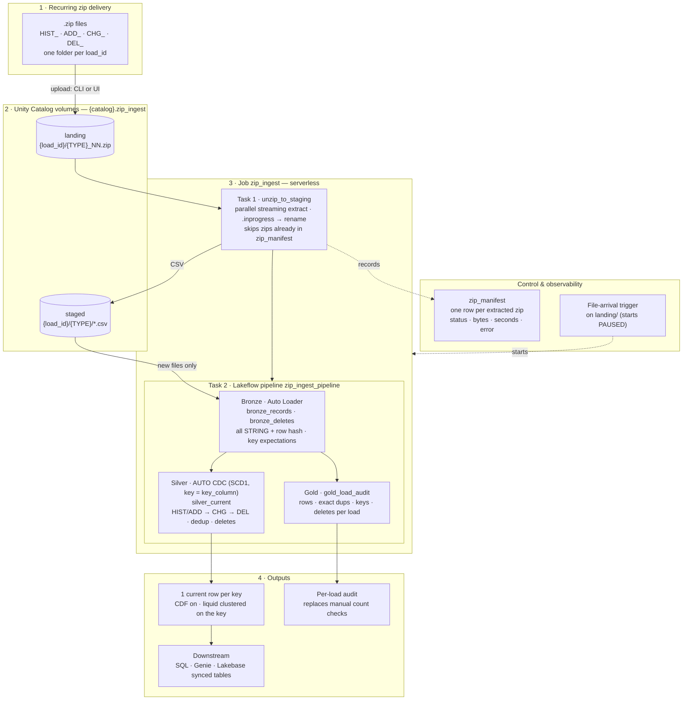

# auto-zip-ingestion

**.zip file ingestion on Databricks**: unzip → Auto Loader → AUTO CDC, deployed as a Databricks Asset Bundle.

Loads recurring `.zip` file deliveries (a historic load, then incremental adds / changes / deletes) into Delta tables, with **one current row per business key** and **no separate pre-processing step** (no unzip → dedup → stitch-to-parquet job).

Auto Loader reads gzip/bzip2 *compressed files* natively, but not `.zip` *archives*, so this repo adds a small, parallel, idempotent unzip step in front of a standard Lakeflow pipeline.

## Architecture



How each step works:

- **Unzip** (`src/01_unzip_to_staging.py`): extracts new zips in parallel and records each one in the `zip_manifest` table, so a zip is never processed twice.
- **Bronze** (`src/transformations/01_bronze.sql`): Auto Loader reads only the CSVs it hasn't seen before. All columns are kept as STRING.
- **Silver** (`src/transformations/02_silver_cdc.py`): AUTO CDC applies, in order, HIST/ADD → CHG → DEL for each load. Exact duplicates collapse onto the same key, changes overwrite, and deletes remove the key.
- **Gold audit** (`src/transformations/03_load_audit.sql`): per load, rows received by file type, exact duplicates, distinct keys, and deletes.

Everything (schema, volumes, pipeline, job) is defined in this repo as a **Databricks Asset Bundle**, so it deploys with one command.

---

## Before you start (checklist)

| You need | How to check |
|---|---|
| A Databricks workspace with **Unity Catalog** and **serverless** jobs/pipelines | In the workspace, **Catalog** appears in the left menu, and **Jobs & Pipelines → Create → ETL pipeline** offers *Serverless* |
| An existing **catalog** where you can create schemas | Run `SHOW GRANTS ON CATALOG <your_catalog>` in the SQL editor. You need `USE CATALOG` + `CREATE SCHEMA` (or ownership). Ask your workspace admin if not. |
| A laptop with a terminal (macOS, Linux, or Windows PowerShell) | — |
| *(optional)* `git` | `git --version` (otherwise download the repo as a ZIP from GitHub) |

---

## Step 1 — Install the Databricks CLI

macOS / Linux:
```bash
brew tap databricks/tap && brew install databricks
# or, without Homebrew:
curl -fsSL https://raw.githubusercontent.com/databricks/setup-cli/main/install.sh | sh
```
Windows (PowerShell):
```powershell
winget install Databricks.DatabricksCLI
```
Check it worked (tested with v1.19; any recent version is fine):
```bash
databricks --version
```

## Step 2 — Log the CLI in to your workspace

Use the workspace URL from your browser (everything up to `.com`):
```bash
databricks auth login --host https://<your-workspace>.cloud.databricks.com --profile zip
```
A browser window opens; sign in. This saves a **profile** called `zip` that the following commands use (`-p zip`).
Check it:
```bash
databricks current-user me -p zip
```

## Step 3 — Get the code

```bash
git clone https://github.com/acsjumpi/auto-zip-ingestion.git
cd auto-zip-ingestion
```
(No git? On GitHub click **Code → Download ZIP**, unzip it, and `cd` into the folder.)

## Step 4 — Deploy

Replace `<your_catalog>` with the catalog from the checklist. The schema defaults to `zip_ingest`; to use another name, add `--var="schema=<name>"`. The schema **must not already exist**.
If your key column isn't called `id`, add `--var="key_column=<your_key_column>"` (e.g. a VIN, account or customer id).

```bash
databricks bundle validate -p zip --var="catalog=<your_catalog>"
databricks bundle deploy   -p zip --var="catalog=<your_catalog>"
```
You should see `Created schemas.zip_ingest_schema`, `volumes.landing`, `volumes.staged`, `pipelines.zip_ingest_pipeline`, `jobs.zip_ingest`.

All settings (pass any of them as `--var="<name>=<value>"`):

| Variable | Default | What it does |
|---|---|---|
| `catalog` | *(required)* | Existing catalog to deploy into |
| `schema` | `zip_ingest` | Schema created for the tables and volumes (must not exist yet) |
| `key_column` | `id` | Business key in every CSV: silver keeps one current row per key |
| `max_workers` | `8` | Zip files extracted in parallel by the unzip task |
| `trigger_status` | `PAUSED` | File-arrival trigger on `landing/` (`PAUSED` or `UNPAUSED`) |

> **Tip:** to avoid typing `--var` every time, set the values once in `databricks.yml` (`variables → <name> → default`).
> Use the **same** `--var` values on every `deploy`/`run`; a different schema name means a separate copy.

## Step 5 — Upload the zip files

**Folder and file names matter.** Put each delivery in its own folder (the folder name becomes the `load_id`, and loads are applied in **alphabetical order**, so use dates), and name files by type:

```
/Volumes/<your_catalog>/zip_ingest/landing/
├── 2026-05_hist/      HIST_01.zip, HIST_02.zip, ...   ← initial/historic load
├── 2026-06/           ADD_01.zip ... CHG_01.zip ... DEL_01.zip ...
└── 2026-07/           ...
```

| Prefix | Meaning | CSV content |
|---|---|---|
| `HIST_` | historic/full load | full records, header row |
| `ADD_` | new records | full records, header row |
| `CHG_` | changed records | full records, header row |
| `DEL_` | deleted keys | header row + the key column only |

Every CSV must have the key column (`key_column`, default `id`). Files that don't start with one of these prefixes are **ignored** (rename them, or edit `FILE_TYPES` in `src/01_unzip_to_staging.py`).

Upload with the CLI (recommended for large files):
```bash
databricks fs cp ./2026-06/ dbfs:/Volumes/<your_catalog>/zip_ingest/landing/2026-06/ --recursive -p zip
```
Or in the workspace UI: **Catalog → <your_catalog> → zip_ingest → Volumes → landing → Create directory**, then **Upload to this volume** (fine for smaller files; use the CLI for multi-GB files).

> **Testing without real files?** `00_generate_test_feed` builds a synthetic delivery from scratch (no input files needed; key column `id`, so keep the default `key_column`).
> In the workspace, open **Workspace → Users → <you> → .bundle → auto_zip_ingestion → dev → files → src → 00_generate_test_feed**, fill in `catalog` (and `schema` if you changed it) in the widgets at the top, and click **Run all** (serverless is fine). It takes a few minutes and writes 2 HIST zips to `landing/2026-05_hist/` and ADD/CHG/DEL zips to `landing/2026-06/`. Then continue with Step 6.

## Step 6 — Run

```bash
databricks bundle run zip_ingest -p zip --var="catalog=<your_catalog>"
```
It prints a **Run URL**. Open it to watch both tasks (`unzip_to_staging` → `ingest_pipeline`). The first run takes a few extra minutes while serverless compute starts.
(UI alternative: **Jobs & Pipelines → zip_ingest → Run now**.)

## Step 7 — Check the results

In the **SQL editor**:
```sql
USE CATALOG <your_catalog>; USE SCHEMA zip_ingest;

-- one row per load: rows received, exact duplicates, distinct keys, deletes
SELECT * FROM gold_load_audit ORDER BY load_id;

-- current records (rows should equal distinct keys); replace `id` with your key column
SELECT count(*) AS rows, count(DISTINCT id) AS keys FROM silver_current;

-- deleted keys still present (should be 0, unless a key was re-added in a later load)
SELECT count(*) FROM silver_current s JOIN bronze_deletes d USING (id);

-- every zip and how long it took to extract
SELECT zip_path, status, csv_bytes, seconds, error FROM zip_manifest ORDER BY started_at DESC;

-- only if you used the test generator: the counts the pipeline should reach
SELECT * FROM gen_expected ORDER BY metric;
```
With the generator's defaults, `silver_current` should have **2,990,000** rows, and the `2026-06` audit row **1,074,572** rows received with **14,572** exact duplicates (matching `gen_expected`).

## Step 8 — Incremental loads

For each new delivery: upload the new folder (Step 5) and run (Step 6). Only new zips and new CSVs are processed.

To run **automatically** when files arrive (5 minutes after the last file stops changing), turn on the trigger:
```bash
databricks bundle deploy -p zip --var="catalog=<your_catalog>" --var="trigger_status=UNPAUSED"
```

---

## Troubleshooting

| Symptom | Cause / fix |
|---|---|
| `PERMISSION_DENIED ... CREATE SCHEMA` on deploy | You don't have `CREATE SCHEMA` on the catalog: ask an admin, or choose a catalog you own. |
| `... already exists` on deploy | The schema name is taken: deploy with `--var="schema=<new_name>"`. |
| Serverless not available | Ask your admin to enable serverless compute for jobs and pipelines. |
| Unzip task prints `0 zip(s) to extract` | Files are not in a `<load_id>/` folder, or names don't start with `HIST_`/`ADD_`/`CHG_`/`DEL_`, or they were already extracted (see `zip_manifest`). |
| A zip shows `FAILED` in `zip_manifest` | Read the `error` column (often a corrupt/partial upload). Re-upload, then run with job parameter `reprocess=<FILE>.zip`. |
| Pipeline shows `key_present` warnings | Rows with an empty key column. They are counted in the pipeline UI (**Data quality** tab), kept in bronze, and dropped before silver. |
| `UNRESOLVED_COLUMN` for the key | `key_column` doesn't match the CSV header (names are case-sensitive): redeploy with the right `--var="key_column=..."`. |
| Changed the transformation code and want to rebuild | Redeploy, then in the pipeline UI choose **Full refresh** for the silver/gold tables. |

Job parameters (UI: **Run now with different parameters**):
- `load_ids`: only process these folders, e.g. `2026-06`.
- `reprocess`: force these zips again, e.g. `CHG_01.zip`.

## Removing it

The schema and volumes are protected (`prevent_destroy`) so that `databricks bundle destroy` can't delete your data by accident. To remove everything on purpose: delete the job and pipeline in the UI, then run `DROP SCHEMA <your_catalog>.zip_ingest CASCADE` in the SQL editor. **This deletes the uploaded zips and all tables.**

---

## Measured results (synthetic data, serverless, no tuning)

**Reproducible with this repo** (`00_generate_test_feed` defaults: 42 columns, 2M historic + ~1.07M incremental rows): the full job (unzip + pipeline, both loads) ran in **~3 min**, and every count matched `gen_expected` (2,990,000 current rows, 14,572 exact duplicates collapsed, 60,000 changes and 10,000 deletes applied).

**At scale** (a wide synthetic CSV feed, ~390 STRING columns, 18M rows; same pipeline):

| Load | Input | Unzip | Pipeline | Result |
|---|---|---|---|---|
| historic | 2 zips, 2.8 GB zip / 9.9 GB CSV, 9.0M rows | 81 s | ~7 min | 9,000,000 keys ✅ |
| incremental | 10 zips (5 ADD, 3 CHG, 2 DEL), 2.9 GB zip / 10.3 GB CSV, 9.37M rows | 72 s | ~8.5 min | 17,954,733 keys = expected ✅; 53,693 exact duplicates collapsed; 45,267 deletes applied (0 remaining) |

Times include ~30 s of serverless start-up. Real files will differ; re-measure with your own deliveries (raise the generator's `hist_rows` / `add_rows` / `columns` widgets to test at your scale).

## Known limitations / next steps

- **Rollback of a bad load across tables** is not built yet. Delta keeps per-table history (`RESTORE TABLE ... TIMESTAMP AS OF`), but rolling back several tables together needs a coordinated step.
- **Column trimming / typing:** bronze and silver keep all source columns as STRING. Add a downstream table that selects and casts the columns you need.
- **Re-ingesting raw data:** Auto Loader skips files it has already read, even if `reprocess` re-extracts them. To rebuild after a logic change, use **Full refresh**.
